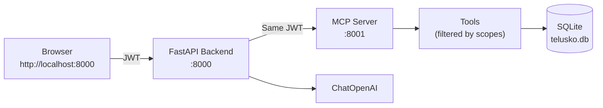

# Telusko Support Chat — MCP with Roles, Scopes & JWT

A customer support desk for an online course platform where **learners**, **support agents**, and **admins** all use the same chat interface. What each person can do is decided entirely by the JWT they carry and the scopes inside it — not by the UI or the prompt.

Built as part of the Telusko *Agentic AI Engineering with Python* course (session 11-10-2026).

**Tech stack:** Python + FastAPI + MCP (Model Context Protocol) + LangChain + OpenAI + SQLite + JWT + Docker

## The One Idea

There is a single chat endpoint and a single model. Nothing in the chat code knows what a learner may do. The difference between Rahul asking “show me my courses” and Akshay asking the same question is the JWT attached to the request, and the MCP server reading the scopes inside it. **The permission system is not in the UI and not in the prompt. It is in the server.**

## Roles

| Role | Who | What they can do |
|------|-----|------------------|
| **learner** | Students | See own courses/payments/certificates, buy a course, raise & reply to own tickets |
| **support** | Support desk | Work the ticket queue, look up learners, extend access (max 30 days), remove enrollments |
| **admin** | Platform owners | Everything support can do + issue certificates, manage FAQs, view stats, manage users |

## Architecture



- The **browser never talks to the MCP server**. It only talks to the backend.
- The backend forwards the same JWT to the MCP server on every tool call.
- The MCP server verifies the token and only exposes / allows tools the caller has scopes for.

## Features

- Role-based access control via **scopes** (`resource:action`) carried in the JWT
- MCP middleware that hides tools the caller cannot use and blocks unauthorized calls
- Data-level rules (e.g. learners can only see their own tickets)
- Full tool-calling loop with a visible trace in the UI (great for learning)
- Simulated course purchase flow
- Admin user management panel (custom permissions possible)
- Fully containerized with Docker Compose

## Quick Start

### With Docker (recommended)

```bash
git clone https://github.com/yash9614/project_mcp.git
cd project_mcp

# Create .env from the example and fill in your values
cp .env.example .env
# Edit .env: add OPENAI_API_KEY and a JWT_SECRET (32+ chars)

docker compose up --build
```

Open http://localhost:8000

### Without Docker

```bash
uv sync
uv run python -m database.db          # create + seed the database (once)
uv run python -m mcp_server.server   # MCP server on :8001
uv run python -m backend.app         # Backend + UI on :8000
```

## Demo Accounts

Password for all: `password123`

| Email | Role |
|-------|------|
| rahul@learner.com | learner |
| priya@learner.com | learner |
| aman@learner.com | learner |
| neha@telusko.com | support |
| vikram@telusko.com | support |
| akshay@telusko.com | admin |

## Project Structure

```
.
├── backend/          # FastAPI app, login, chat loop, admin endpoints
├── common/           # config, auth (JWT), permissions, prompts
├── database/         # schema.sql, seed.sql, models.py, db.py
├── mcp_server/       # MCP server: JWT verifier, middleware, tools
├── frontend/         # Single-file HTML UI
├── docker-compose.yml
├── Dockerfile
└── pyproject.toml
```

## Key Design Decisions

- **Scopes travel in the JWT.** The MCP server never looks up the user in the database to decide permissions — it only trusts the verified token.
- **Tool visibility is filtered.** `tools/list` only returns tools the caller has a scope for.
- **One client per request.** The backend opens a fresh MCP connection for each chat turn, authenticated with that user’s JWT.
- **Models layer owns all SQL.** Tools never write raw SQL; they call methods on the dataclass models.
- **SQLite for simplicity.** No external database required for the class project. Moving to Postgres later only requires changing `database/db.py`.

## What to Try

1. Log in as **Rahul** (learner) → ask about your courses / certificate / failed payment.
2. Log in as **Neha** (support) → list open tickets, look up Priya, try extending access by 60 days (blocked).
3. Log in as **Akshay** (admin) → issue a certificate, view stats, open Manage Users.

Watch the tool-call traces under each assistant reply — they show exactly which MCP tools were invoked and what they returned.

## Bonus Material

See [CONCEPTS.md](CONCEPTS.md) for the most important concepts and interview-style questions.
